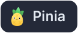

<div align="center">

<picture>
  <source media="(prefers-color-scheme: dark)" srcset="assets/banner.svg" />
  
</picture>

<p>
  <a href="https://t.me/e_nagorniak"></a>
  <a href="https://www.linkedin.com/in/e-nagornyak"></a>
  <a href="https://www.codewars.com/users/e_nagornyak"></a>
  <a href="https://instagram.com/e.nagorniak"></a>
</p>

</div>

## 🧑‍💻 About Me

```ts
const evhen = {
  role: "Full-Stack & Mobile Developer",
  location: "Ukraine 🇺🇦",
  focus: ["Web", "Mobile", "Scalable Architectures"],
  frontend: ["React", "Next.js", "Vue", "Nuxt", "React Native"],
  backend: ["Node.js", "NestJS", "PostgreSQL", "Prisma"],
  currentlyLearning: ["Micro-frontends", "Cloud & DevOps", "Web Performance"],
  funFact: "I debug with console.log and I'm proud of it 🙃",
};
```

## 💻 Tech Stack

**⚛️ Frontend**<br />
        

**🗂️ State & Data**<br />
     

**📝 Forms & Validation**<br />
 

**🎨 UI & Styling**<br />
    

**📱 Mobile & Desktop**<br />
  

**🔧 Backend**<br />
   

**💾 Databases**<br />
  

**🏗️ Architecture**<br />
  

**🧪 Testing**<br />
 

**🛠️ DevOps & Tools**<br />
       

**🖌️ Design**<br />
 


## 🏆 Competitive Programming

<a href="https://www.codewars.com/users/e_nagornyak"></a>

## 📈 Always Growing

I care about clean code, scalable architecture and great user experiences. Right now I'm going deeper into **Nx monorepos**, **headless UI** patterns (Radix + shadcn) and **performance-first** web and mobile apps.

<a href="https://t.me/e_nagorniak">
  <picture>
    <source media="(prefers-color-scheme: dark)" srcset="assets/footer.svg" />
    
  </picture>
</a>
